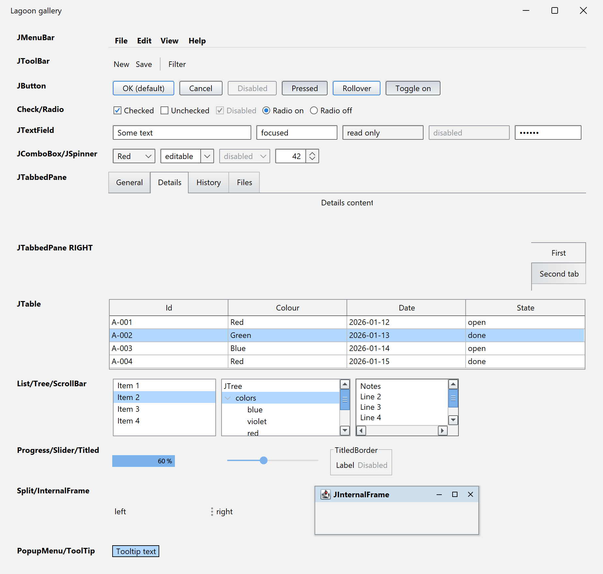
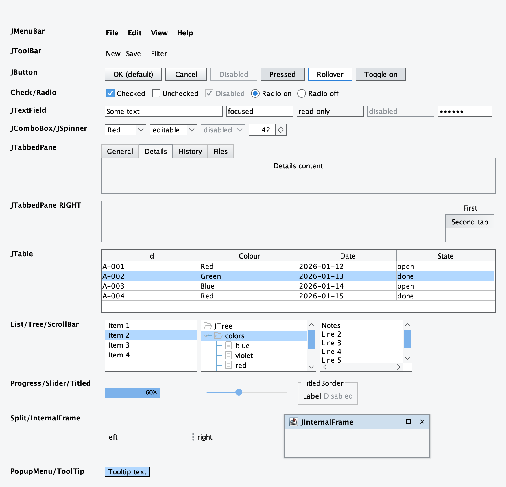

# swing-flatlaf-lagoon-theme

[](https://github.com/kormcrete/swing-flatlaf-lagoon-theme/actions/workflows/build.yml)
[](LICENSE)

A classic light theme for [FlatLaf](https://www.formdev.com/flatlaf/).

<p>
  
  
</p>

<sub>Windows (left) and macOS (right): <code>LagoonGallery</code>, captured at 2x with
<a href="https://github.com/kormcrete/swing-ui-agent">swing-ui-agent</a>.</sub>

A neutral grey palette, softened corners, one-pixel dark frames set in a light ring, bevelled buttons, framed card
tabs, white tables with a grid and blue scroll bars with buttons: the clearly delimited look of a traditional desktop
application, for forms and data-heavy screens, on FlatLaf Light's layout and sizes — with everything FlatLaf brings
underneath: HiDPI scaling, native window decorations, SVG icons and an actively maintained look-and-feel. An
application that wants it denser turns on a few switches (see *A denser, classic look*).

## Use

Not on Maven Central yet: build it with `mvn install`, then depend on the snapshot.

```xml
<dependency>
    <groupId>io.github.kormcrete</groupId>
    <artifactId>swing-flatlaf-lagoon-theme</artifactId>
    <version>1.0.0-SNAPSHOT</version>
</dependency>
```

FlatLaf comes in as a transitive dependency (3.7.1); declare your own FlatLaf dependency to pin
another version.

```java
import io.github.kormcrete.flatlaf.lagoon.FlatLagoonLaf;

FlatLagoonLaf.setup();   // before the first Swing component is created
```

### Fonts

Like FlatLaf Light, the theme uses the platform's UI font; menus, the toolbar and frame titles are
bold. An application that wants another base font sets its own `defaultFont` before calling
`setup()`; the theme leaves it alone (for fonts based on Dialog 12, see `Lagoon.dialogFont` below):

```java
UIManager.put("defaultFont", new Font(Font.SANS_SERIF, Font.PLAIN, 13));
FlatLagoonLaf.setup();
```

### Switching at runtime

Like any FlatLaf theme:

```java
FlatLagoonLaf.setup();
FlatLaf.updateUI();
```

## What is in it

- `FlatLagoonLaf` — a `FlatLightLaf` subclass; FlatLaf loads `FlatLagoonLaf.properties` from the
  same package. The properties file is the one place that names colours and sizes, and is
  commented section by section.
- `LagoonTabbedPaneUI` — FlatLaf's card tabs frame only the selected tab; this theme frames and
  shades the unselected ones too. Its two colours are properties keys
  (`TabbedPane.unselectedBorderColor`, `TabbedPane.unselectedBottomColor`), and it handles all
  four tab placements.
- `LagoonBorders` — fields, combo boxes, spinners, buttons and scroll panes set their frame in an
  etched ring (`Component.ringShadowColor` above and left, `Component.ringHighlightColor` below and
  right) in every enabled state, in the space FlatLaf reserves for its focus ring. A focused
  field's frame turns `Component.focusColor` and grows one pixel inwards.
- Sizes, paddings, row heights, the message dialog layout and trees follow FlatLaf Light's
  defaults. The palette is built on `@background` (#F2F2F2, FlatLaf Light's grey): one line in an
  application's properties re-tints every panel, toolbar, header and button with it.
- A focused table, list or tree shows its selection strongly (`@selectionBackground` with white
  text), an unfocused one in a pale blue.
- `LagoonSheen` — the raised face of buttons: a soft gradient under a one-pixel highlight, turned
  over and darker when pressed (`Lagoon.sheen.*` keys); hover shows in the frame. A button with a
  colour of its own, set or from a FlatLaf style (a primary action, say), is painted flat in that
  colour, under its own foreground.
- `LagoonTableHeaderUI` — a header the theme draws is as tall as its text.
- `LagoonTreeUI` — a tree that sets `JTree.lineStyle` to `"None"` paints no lines, as in Swing's
  own look-and-feels.
- `LagoonComboBoxUI`, `LagoonSpinnerUI`, `LagoonLabelUI`, `LagoonButtonUI` — FlatLaf's arrows and
  sizes by default; the switches below give the classic variants.

Still to follow as further UI delegates: the raised face on table headers, and a gradient on the
menubar, toolbar and scroll thumb.

## A denser, classic look

An application turns these on in its own `FlatLagoonLaf.properties`, registered as FlatLaf custom
defaults before the theme is installed. All are `false` by default:

| Key | Effect |
|---|---|
| `Lagoon.dialogFont` | Fonts based on Dialog 12 instead of the platform's UI font. |
| `Lagoon.labelGap` | Labels, table cells, tree rows and buttons keep their icon-text gap after the text even without an icon; text above or below an icon gets the gap twice. |
| `Lagoon.oddButtonSize` | Buttons get an odd width and height. |
| `Lagoon.raisedArrowButtons` | Combo boxes and spinners get small raised arrow buttons with solid triangles, set inside the frame. |

```java
FlatLaf.registerCustomDefaultsSource("com.example.app.theme"); // holds com/example/app/theme/FlatLagoonLaf.properties
FlatLagoonLaf.setup();
```

The same file can set any other key, e.g. `@background`, `Table.rowHeight` or `TextField.margin`.
`src/test/resources/io/github/kormcrete/flatlaf/lagoon/dense/FlatLagoonLaf.properties` is a complete
example: every switch on, with the denser sizes, palette, trees and message layout the theme had
before its defaults followed FlatLaf Light.

## Notes for applications

- Cell renderers that keep Swing's static `DefaultTableCellRenderer.noFocusBorder` (one pixel) and
  take the focus border from the look-and-feel shift their text when a cell gains the focus, because
  FlatLaf's cell margins are wider. Read `Table.cellNoFocusBorder` from `UIManager` instead, or set
  `Table.cellMargins = 1,1,1,1` in the application's own properties.
- FlatLaf honours `apple.laf.useScreenMenuBar` on macOS, which some other look-and-feels ignore.
  If your menu bar moves to the top of the screen after switching, that property is why.
- On Java 24 and later, FlatLaf's native library (window decorations and other platform
  integration) prints a "restricted method" warning when it loads; a future Java will block it.
  Start the application with `--enable-native-access=ALL-UNNAMED`, or add
  `Enable-Native-Access: ALL-UNNAMED` to an executable jar's manifest.

## Build

```
mvn package
```

Java 8 or later; CI runs the tests on Java 8 and 25, on Linux, macOS and Windows. Tests are headless. `LagoonGallery` (under `src/test`) opens a window with one
of everything, for a visual check:

```
mvn -q test-compile exec:java -Dexec.classpathScope=test -Dexec.mainClass=io.github.kormcrete.flatlaf.lagoon.LagoonGallery
```

## Licence

Apache License 2.0 — see `LICENSE` and `NOTICE`.
